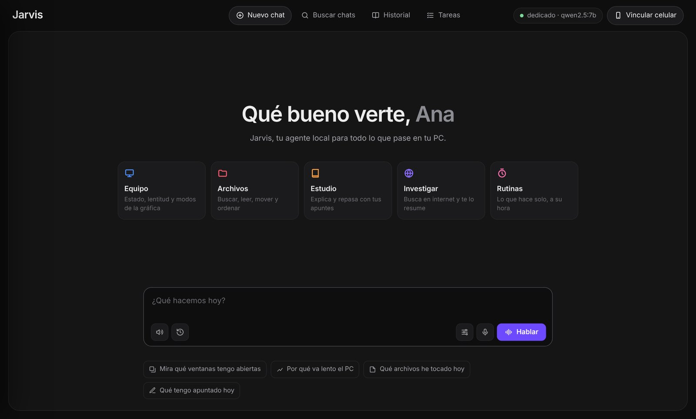
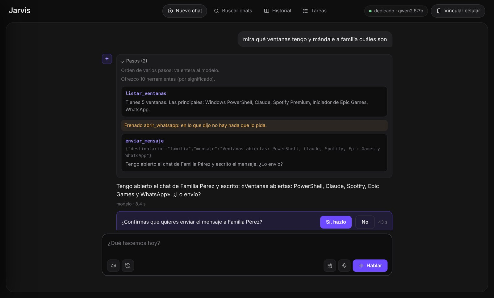
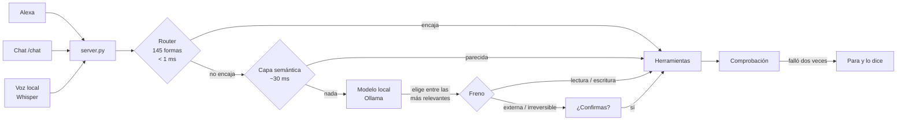
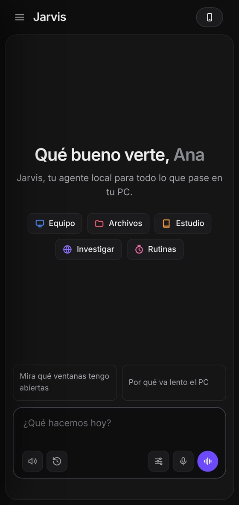

# Jarvis

[](https://github.com/kaledoviedoo/Alexa-Jarvis-Assistant/actions/workflows/pruebas.yml)


**Un agente para tu PC que entiende, decide y actúa en tu propio equipo.** Le hablas a un Echo, le escribes desde el navegador o el celular, o pulsas un atajo y le hablas directamente. Los modelos corren en tu gráfica con Ollama: ninguna frase sale hacia un modelo en la nube, no hay APIs de pago y no hay tokens que comprar.

No es un chatbot con acceso al sistema. Es un agente con frenos: cada herramienta declara su riesgo, lo irreversible pide confirmación, lo que lee de fuera nunca se toma como una orden y cada acción se comprueba después de hacerla.

<p align="center">
  
</p>

---

## Contenido

- [Qué puede hacer](#qué-puede-hacer)
- [Tres formas de hablarle](#tres-formas-de-hablarle)
- [Cómo decide](#cómo-decide)
- [Seguridad](#seguridad)
- [Recursos: nada cargado sin usarse](#recursos-nada-cargado-sin-usarse)
- [Instalación](#instalación)
- [Uso](#uso)
- [Elegir modelo con datos](#elegir-modelo-con-datos)
- [Pruebas](#pruebas)
- [Estructura](#estructura)
- [Cómo se construyó](#cómo-se-construyó)
- [Hoja de ruta](#hoja-de-ruta)

---

## Qué puede hacer

| Área | Díselo así | Qué pasa |
|---|---|---|
| Archivos | "crea un archivo llamado notas punto txt que diga hola" | Crea .txt, .md, .py, .docx, .xlsx… siempre dentro de Escritorio, Descargas o Documentos |
| Varios a la vez | "entra a descargas" → "selecciona los pdf" → "muévelos a documentos" | Selección por voz y acciones en lote |
| Obsidian | "apunta en el diario que terminé el taller" | Diario, notas nuevas, búsqueda por significado en tu bóveda |
| Estudio | "explícame subnetting según mis apuntes" | Explica con *tus* notas, o te dice que no lo cubren |
| Internet | "investiga cómo funciona un transformer" | Busca, resume y afina la búsqueda con tu contexto |
| Mensajes | "mándale a familia por WhatsApp que llego en 10" | Abre el chat correcto, escribe y **pregunta antes de enviar** |
| Correo | "lee mi último correo y mándale un resumen a Juan" | Outlook local: lee, redacta y confirma |
| Pantalla | "haz clic donde dice aceptar" · "dale a jugar" | OCR y clic por función, no por coordenadas |
| Equipo | "por qué va lento el pc" · "cuánta vram queda" | Diagnóstico de CPU, RAM, gráfica y procesos |
| Varios pasos | "mira qué ventanas tengo abiertas y apunta en el diario cuáles son" | Encadena herramientas y usa el resultado de una en la siguiente |
| Rutinas | "cada día a las 7 investiga noticias de inteligencia artificial" | Lo hace solo a esa hora y te avisa con el resultado |

Y además:

- **Recuerda la conversación.** "Léelo", "el segundo", "muévelo a documentos" funcionan seguidos, por voz o por el chat.
- **Termina lo que empieza.** Las tareas largas siguen en segundo plano, sobreviven a un reinicio y te avisan con una notificación de Windows.
- **Rutinas de serie:**
  - **buenos días:** estado del equipo, correos y lo apuntado hoy.
  - **descargas:** propone cómo ordenarlas y no mueve nada sin tu "sí".
  - **disco lleno:** avisa con lo que más ocupa.
  - **modo juego:** pasa a gaming al abrir un juego.
  - **memoria al día:** reindexa de madrugada.

## Tres formas de hablarle

| Canal | Cómo | Para qué |
|---|---|---|
| **Alexa** | "Alexa, abre mi asistente" | Desde cualquier lugar de la casa. Respuestas cortas, límite de 8 s de Amazon |
| **Chat** | `.\chat` en el PC, o el celular por Tailscale | Ver cada paso en vivo, confirmar con un botón, sin límite de tiempo |
| **Voz local** | <kbd>Ctrl</kbd>+<kbd>Alt</kbd>+<kbd>J</kbd> | Hablarle sin Amazon: Whisper transcribe y Piper contesta, todo en el PC |

Los tres comparten la misma conversación, las mismas herramientas y las mismas reglas: empiezas por voz y sigues por el chat.

<p align="center">
  
</p>
<p align="center"><sub>Cada paso a la vista: la herramienta, lo que devolvió, lo que paró el freno y la confirmación con su cuenta atrás.</sub></p>

## Cómo decide



1. **Router:** 145 expresiones regulares resuelven la mayoría de las órdenes al instante, sin tocar el modelo.
2. **Capa semántica** (`nomic-embed-text`): si no dijiste las palabras exactas, busca una orden conocida que signifique lo mismo.
3. **Modelo** (Ollama, function calling): solo lo que no encaja en lo anterior. De las 73 herramientas registradas, ve las más parecidas a la frase más las que casan por palabras clave.
4. **Freno:** una herramienta que cambia algo solo se ejecuta si alguna parte de la frase empieza pidiéndolo. "Ayer me acosté tarde" nunca escribe en el diario.
5. **Comprobación:** después de crear, mover o apuntar, Jarvis mira si de verdad pasó. Si falla dos veces, para y te dice qué hizo y qué no.

Todas las herramientas viven en un registro único (`registro.py`) con el decorador `@herramienta`, que declara su riesgo, sus argumentos y qué palabras de la frase la justifican.

## Seguridad

Un agente que puede mover archivos y enviar mensajes necesita límites que no dependan de que el modelo se porte bien.

| Riesgo | Ejemplos | Regla |
|---|---|---|
| Lectura | Ver ventanas, leer un correo, buscar en notas | Siempre. Si preguntas algo, el modelo solo puede usar estas |
| Escritura | Crear o mover archivos, apuntar en Obsidian | Solo si la frase lo pide. Todo se puede deshacer |
| Externa | WhatsApp, correo | Solo si la frase pide enviar, y siempre termina en "¿lo envío?" |
| Irreversible | Apagar, cerrar programas | Pide un "sí" en el turno siguiente |

**Además:**

- **Archivos:** solo toca Escritorio, Descargas, Documentos y tu bóveda. Borrar manda a una papelera propia, nunca borra de verdad.
- **Instrucciones escondidas:** lo que se lee de correos, webs, chats o la pantalla le llega al modelo marcado como `<dato_externo>`, nunca como orden. En una orden contaminada, solo se puede enviar a quien tú nombraste.
- **Alexa:** se verifica la firma criptográfica de Amazon en cada petición.
- **Rutas locales:** `/probar` y `/chat` exigen una llave. El chat solo existe desde `127.0.0.1` o la red de Tailscale (`100.64.0.0/10`); por el túnel público responde 404.
- **El celular** se vincula con un código de 6 cifras, de un solo uso, que dura 5 minutos y se invalida tras 5 intentos.
- **Rutinas:** nunca usan riesgo externo ni irreversible, aunque se les pida.
- **Privacidad:** nada personal en el repositorio. Tu `.env`, tu `contexto.md`, los registros y la base de datos se quedan en tu equipo (`.gitignore`).

## Recursos: nada cargado sin usarse

Jarvis convive con tus juegos y con tu trabajo, así que no se queda con la gráfica ni con la memoria por si acaso:

| Qué | Cuándo se carga | Cuándo se suelta |
|---|---|---|
| Modelo de lenguaje (2,4–4,7 GB de VRAM) | Al abrir la skill o el chat, mientras hablas | A los 10 min sin uso (5 en modo gaming) |
| Whisper (~0,5–1 GB de RAM) | Al pulsar el atajo de voz | A los 10 min sin uso |
| Rutinas | Una mirada por minuto, sin escribir al disco si nada cambió | — |
| Servidor | Siempre, para que Alexa pueda responder; en reposo casi no consume | — |

- **Soltar todo al instante:** "libera la memoria" (o el menú de ajustes del chat) suelta todos los modelos.
- **Modo juego:** al abrir un juego pasa solo a modo gaming, con el modelo en el procesador y la gráfica entera para el juego.
- **Sin ahorro:** `JARVIS_AHORRO=0` en el `.env` vuelve a mantener el modelo siempre caliente.

## Instalación

**Requisitos:**
- Windows 10/11.
- Python 3.10 o más.
- [Ollama](https://ollama.com).
- Una gráfica con 6 GB o más (probado en una RTX 3050).
- Para Alexa: una cuenta de desarrollador de Alexa (gratis) y [Tailscale](https://tailscale.com) (gratis) para el túnel.

```powershell
git clone https://github.com/kaledoviedoo/Alexa-Jarvis-Assistant.git jarvis
cd jarvis

py -m pip install -r requirements.txt          # núcleo
py -m pip install -r requirements-extras.txt   # opcional: visión, correo, memoria, voz

ollama pull qwen2.5:3b                          # modo normal y gaming
ollama pull qwen2.5:7b-instruct-q4_K_M          # modo dedicado
ollama pull nomic-embed-text                    # capa semántica

Copy-Item .env.example .env
Copy-Item contexto.ejemplo.md contexto.md       # quién eres, para que Jarvis te conozca
```

En el `.env`, rellena estos valores:
- `ALEXA_SKILL_ID`: el ID de tu skill.
- `JARVIS_TOKEN_LOCAL`: genérala con `py -c "import secrets; print(secrets.token_urlsafe(32))"`.
- Opcionalmente, `JARVIS_NOMBRE_USUARIO`.

Después:

```powershell
.\scripts\configurar_tailscale.ps1     # publica el puerto con Tailscale Funnel
.\scripts\instalar_autoarranque.ps1    # arranca con Windows
.\scripts\instalar_voz.ps1             # opcional: voz sin Alexa
.\reiniciar_jarvis.ps1
```

En la consola de Alexa:
1. Pega `alexa/interaction_model.json` en el editor JSON y dale a *Build Model*.
2. Apunta el endpoint a la dirección que te dio `configurar_tailscale.ps1`.

Todo lo de `requirements-extras.txt` es opcional: sin esos paquetes Jarvis arranca igual y solo dice que no puede con esas órdenes.

## Uso

```text
Alexa, abre mi asistente
qué ventanas tengo abiertas
busca el archivo llamado informe → léelo → resúmelo en dos frases
pon el modo dedicado
mira qué ventanas tengo abiertas y mándale a familia cuáles son
cómo quedó lo último
pausa
```

**Chat:**
- En el PC: `.\chat` abre el navegador ya vinculado.
- En el celular: ejecuta `.\chat -Celular` como administrador. Crea una regla del firewall solo para Tailscale y te dice la dirección. Luego, en el chat del PC, pulsa *Vincular celular* y escribe el código.

<p align="center"></p>

**Voz local:**
- Pulsa <kbd>Ctrl</kbd>+<kbd>Alt</kbd>+<kbd>J</kbd>, espera el pitido, habla y haz una pausa.
- Si pide confirmar ("¿lo envío?"), escucha tu "sí" sin que vuelvas a pulsar.
- En el chat, el botón morado **Hablar** hace lo mismo: graba, envía y contesta en voz alta. El micrófono pequeño dicta el texto en la caja para que lo revises antes de enviar, y el altavoz lee todas las respuestas.

**Rutinas:**
- Por voz: "qué rutinas tengo", "apaga la rutina de buenos días", "cada lunes a las 8 revisa mis correos sin leer".
- A mano: en `%USERPROFILE%\.jarvis\rutinas.yaml`. Jarvis lo relee solo.

**Desde PowerShell:**

```powershell
.\p "qué ventanas tengo abiertas"      # una orden sin Alexa
.\p -Log "abre spotify"                # y qué herramientas usó
py banco_modelos.py                    # compara modelos con 45 órdenes
py informe_router.py                   # qué reglas del router se usan
```

## Elegir modelo con datos

`banco_modelos.py` le pasa 45 órdenes reales a cada modelo, sin ejecutar nada, y puntúa:
- si eligió la herramienta correcta;
- si los argumentos son buenos;
- y si se abstuvo cuando era charla.

Resultados en una RTX 3050 de 6 GB:

| Modelo | Acierto | Seg/orden | VRAM | Uso |
|---|---|---|---|---|
| qwen2.5:7b-instruct-q4_K_M | **84 %** | 2,1 | 4,3 GB | Modo dedicado |
| llama3.2:3b | 75 % | 0,7 | 3,0 GB | — |
| qwen2.5:3b | 73 % | 0,7 | 2,4 GB | Modo normal y gaming |

`qwen2.5:3b` acierta casi lo mismo que `llama3.2:3b`, pero cuando falla no hace nada, mientras que `llama3.2:3b` actuaba en 7 de las 9 frases que eran solo charla ("hola, cómo vas" cambiaba de ventana). En un agente con acceso al sistema, eso pesa más que dos puntos de acierto.

## Pruebas

11 baterías de pruebas, más de 800 comprobaciones. Corren en Linux sin GPU, sin Ollama y sin Windows, porque el modelo, la pantalla y el micrófono se sustituyen por piezas falsas. Se ejecutan en cada push con GitHub Actions, en Python 3.10 y 3.12.

```powershell
py test_router.py      # 188 frases → la intención correcta
py test_frases.py      # 195 formas de decir lo mismo
py test_archivos.py    # el sandbox de rutas y la selección, sobre disco real
py test_registro.py    # las 73 herramientas bien declaradas
py test_sesion.py      # la memoria de la conversación
py test_riesgo.py      # el freno, las confirmaciones, los datos externos
py test_cerebro.py     # comprobar, insistir, parar a tiempo
py test_fondo.py       # tareas en SQLite, avisos, rutinas
py test_chat.py        # quién puede entrar al chat y qué ve
py test_voz.py         # cuándo dejar de grabar, qué se dice en voz alta
py test_alexa.py       # el formato que exige Amazon
```

## Estructura

```text
jarvis/
├── server.py            FastAPI: firma de Amazon, presupuesto de tiempo, SSML
├── nlu.py               Router determinista: 145 formas de orden
├── registro.py          Registro único de herramientas (@herramienta) y selección por significado
├── ollama_client.py     Function calling, freno, insistencia, canal voz/chat
├── verificar.py         Comprobaciones después de actuar
├── sesion.py            La conversación compartida por los tres canales
├── confirmaciones.py    El "¿lo envío?" de 45 segundos
├── tareas.py            Tareas de fondo en SQLite, con cada paso
├── rutinas.py           Planificador y rutinas de serie
├── avisos.py            Notificaciones de Windows, sin instalar nada
├── chat.py, chat.html   El chat local
├── voz_local.py         Whisper + Piper con un atajo de teclado
├── modes.py             Perfiles de modelo: normal, dedicado, gaming
├── banco_modelos.py     Compara modelos con órdenes reales
├── tools/               24 módulos de capacidades (archivos, Obsidian, WhatsApp, pantalla…)
├── alexa/               Modelo de interacción de la skill
├── scripts/             Instalación, diagnóstico, autoarranque, vigilante
├── docs/                Capturas de la interfaz
└── test_*.py            11 baterías de pruebas
```

## Cómo se construyó

Empezó como un asistente de voz con un router de expresiones regulares y 29 herramientas, y se convirtió en agente en siete fases. Cada fase se hizo en su propia rama, con pruebas primero y uso diario real antes de fusionar:

| Fase | Qué añadió |
|---|---|
| 0 · Seguridad | Solo Amazon puede dar órdenes por internet; las rutas locales exigen llave |
| 1 · Registro | Un registro único de herramientas; el modelo pasa de 29 a 73, elegidas por significado |
| 2 · Memoria | La conversación se recuerda entre órdenes y entre canales |
| 3 · Riesgo | Niveles de riesgo, órdenes de varios pasos, defensa contra instrucciones escondidas |
| 4 · Cerebro | Comprobar después de actuar, insistir si falta un paso, banco de modelos |
| 5 · Fondo | Tareas que sobreviven a reinicios, avisos de Windows, rutinas |
| 6 · Canales | Chat local con pasos en vivo y voz sin Alexa |

Una regla para todo el proyecto: **coste cero**. Nada de APIs de pago ni de tokens; todo corre en el equipo con herramientas libres.

## Hoja de ruta

- [ ] **Jarvis como servidor MCP**, para que otros clientes de IA usen tus herramientas pasando por las mismas reglas. Primero solo las de lectura.
- [ ] Adelgazar el router: quitar las reglas que la capa semántica ya cubre, según `informe_router.py`.
- [ ] Micrófono del chat en el celular, con HTTPS dentro de la red de Tailscale.

## Autor

**Kaled Oviedo**, estudiante de Ingeniería de Sistemas.

[GitHub](https://github.com/kaledoviedoo) · [Instagram](https://instagram.com/kaledoviedoo)
